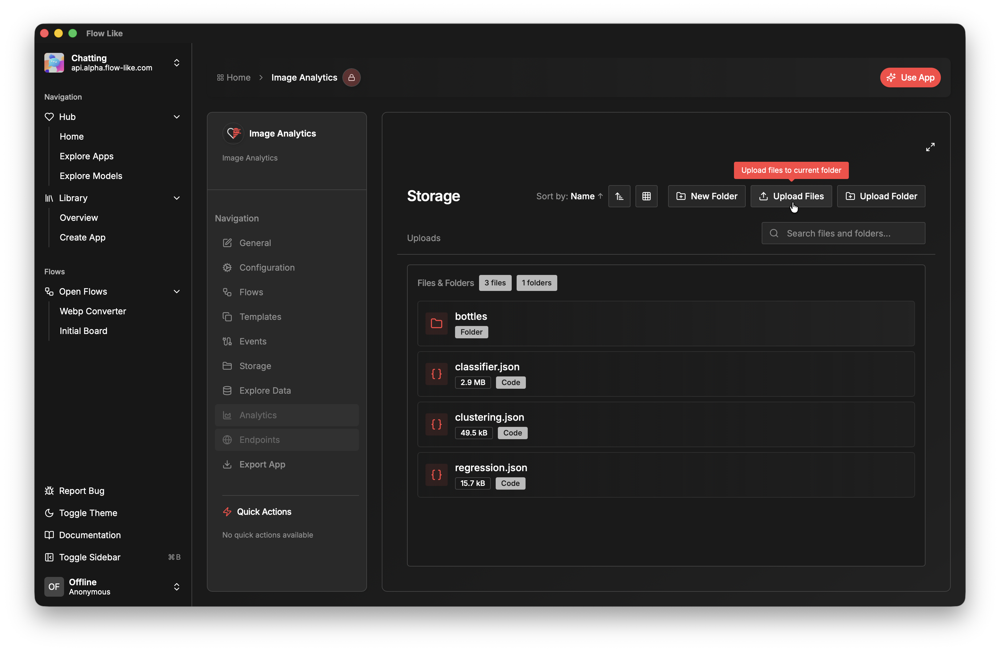

Every Flow-Like app has its own **file storage** for the assets your flows read and write. Two views manage it:

- **Storage**: upload and manage shared files and directories for the app. Select files from your local machine or drag and drop them directly.
- **User Storage**: browse and search your own private, per-user files within the app.

:::tip[Looking for databases?]
Relational tables and the semantic layer built on top of them now live in **[Data Studio](/apps/data-studio/)**.
:::

**User Storage** appears in the App navigation when [Developer
Mode](/start/developer-mode/) is enabled. Access permissions still apply to both
views. For queued uploads and cached tables in an online App, see
[Offline access](/apps/offline-access/).

## Upload Directory
Here you can upload files and entire folders to make them part of your app. For online apps, the files are stored in the cloud and synchronized across all devices where you are logged in with your Flow-Like account:

## Rename files and folders

In **Storage** or **User Storage**, open a file or folder's actions menu and
choose **Rename**. Enter a new name and confirm. Renaming requires permission to
write files and keeps the item in its current parent folder. A folder rename
also moves its contents. An existing file or folder with the new name blocks
the rename.

Renaming changes storage paths. Update any flows or widgets that reference the
old path, including paths inside a renamed folder.

Cloud folder renames copy the contents before deleting the original objects.
Avoid editing or uploading into the folder while it is being renamed. If a
rename fails, some copies may remain under the new name. On Amazon S3, the
conditional copy preserves file contents but does not retain the source
object's metadata or tags.

## View and edit files

Select a supported file in **Storage** to open its viewer. The editor loads on
demand. PDFs, common images, audio and video open inline beside the file list.
PDFs use the browser's reader with zoom and page controls. Audio and video keep
their playback controls. Choose **Edit** to open the corresponding editor.

If your role allows writing files, choose **Edit**, make changes, then
**Save**. Saving updates the selected file in its current folder. Closing an
editor with unsaved changes asks whether to discard them. When an editor can
import a format but cannot export it, the button names the output format, such
as **Save as .xlsx**. That action creates a distinctly named file in the same
folder and leaves the source available. Further saves update that converted file
while the editor stays open.

| Editor | Supported file families | Save behavior |
| --- | --- | --- |
| Flows Word | DOCX | Saves DOCX |
| Flows PDF | PDF | Browser reading, PDF editing and saving |
| Flows Slides | PPTX, POTX, PPSX | Saves PPTX; templates and slide shows convert to PPTX |
| Flows Sheets | XLSX, XLSM, XLTX, XLTM, CSV, TSV, TAB; imports XLS, XLT, XLSB, ODS | Saves supported modern formats; older workbooks and ODS convert to XLSX |
| Flows Vector | SVG, SVGZ, PDF-compatible AI, EPS, EMF, WMF, VectorCraft projects and templates | Saves matching formats; imported DrawCraft and Affinity designs convert to VectorCraft |
| Flows Photo | PNG, JPEG, TIFF, BMP, PSD, PSB, OpenRaster, PhotoCraft and other supported raster formats; imports RAW, KRA and PDN | Saves matching raster formats; import-only files and animated formats save as PhotoCraft projects |
| Flows Audio | WAV, AIFF, FLAC, MIDI, SoundCraft; imports MP3, OGG, M4A, AAC and other supported audio | Saves WAV, AIFF, FLAC, MIDI or bundled SoundCraft sessions; compressed audio converts to WAV |
| Flows Video | MP4, MOV, WebM, MKV, AVI and other supported video containers | Saves MP4 |
| Flows CAD | DXF | Saves DXF |
| Flows Design | IDML, DesignCraft | Saves the selected layout format |

These editors are available in the shared **Storage** configuration tab on web
and desktop. They run in the browser and send saved bytes through the existing
storage connection. File contents are not sent to Storytold. Browser codec
availability can limit video imports and exports.

Editing is experimental. Unsupported formatting, layers, animation or document
features may change when saved. Import warnings appear above the editor. Some
RAW and layered image formats open an embedded preview rather than their full
source data. Animated images currently open a single frame, so their Save action
creates a PhotoCraft project. IDML support omits some structures, including
tables, footnotes, anchored objects and hyperlinks. Layout files that reference
external graphics need those assets embedded to be self-contained. Review
important files in their original application after saving.

Word, presentation, spreadsheet, vector, photo and layout editors accept files
up to 50 MiB. Audio and CAD accept 100 MiB; PDF and video accept 200 MiB.
Legacy `.doc` and `.ppt`, OpenDocument presentations, InDesign `.indd` and
After Effects `.aep` files are not supported. CADCraft's DWG support is desktop-only
upstream and is unavailable in these browser-based editors. TypeScript `.ts` files retain their
code preview. LightCraft catalogs and EffectCraft projects depend on separate
media libraries, so they do not open as standalone storage files.

## Models and training history

Trained models are published as files under `storage/models` in **Storage**,
or under `models` in **User Storage** for models trained on your own tables.
They sync like any other app file, ship to devices with a deployment and travel
in app archives, so other runtimes can run them. Forks that do not copy data
leave `storage/models` out. Model folders are written once and checked by
sha256; a file edited by hand there stops its model from loading.

The training history behind these models stays on the computer or device that
trained them. Only **Export Training Ledger** and **Import Training Ledger**
move it. See [Training history and published
models](/topics/datascience/ml-auto-training/#training-history-and-published-models).
